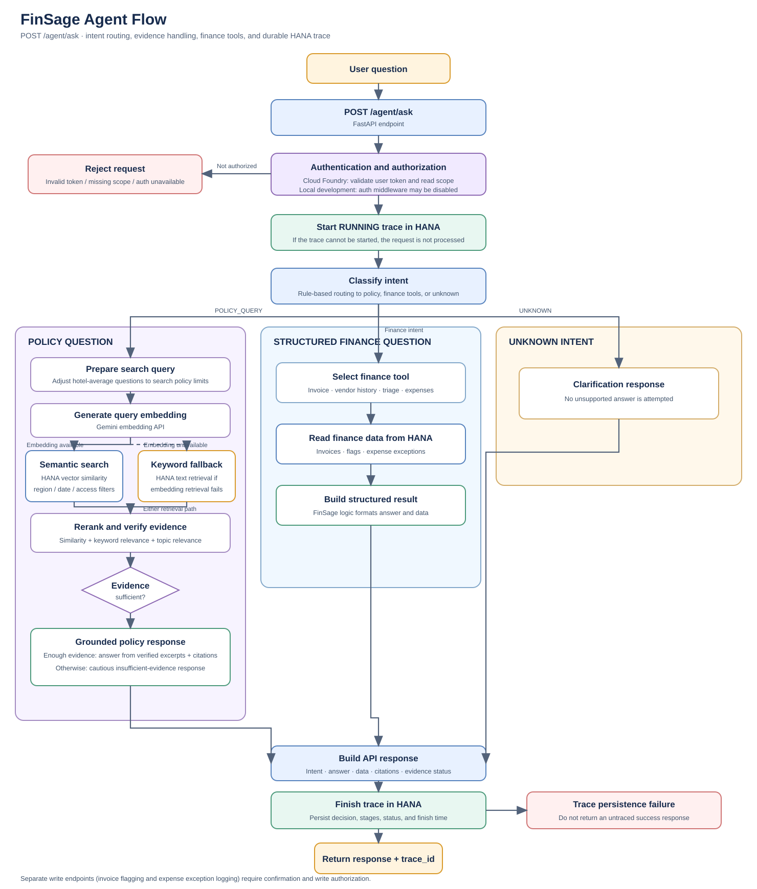

# FinSage Agent Flow

The flow below covers the `POST /agent/ask` path. Other invoice and expense
endpoints call their corresponding HANA tools directly; the flag-invoice and
log-exception endpoints require explicit confirmation before writing.

## Agent outcomes

- **Policy questions:** Search HANA chunks using Gemini embeddings and cosine
  similarity, or use the HANA text fallback when embedding retrieval is
  unavailable. Rerank and verify evidence before returning a cited answer.
  Insufficient or irrelevant evidence leads to a cautious response.
- **Structured finance questions:** Route to invoice summary/detail, vendor
  invoice history, invoice triage, or expense exception tools. Results are
  assembled by FinSage from HANA data.
- **Unknown questions:** Return a clarification response instead of attempting
  an unsupported answer.
- **Tracing:** Start a HANA trace before processing and persist its final
  decision/status before returning the result.

