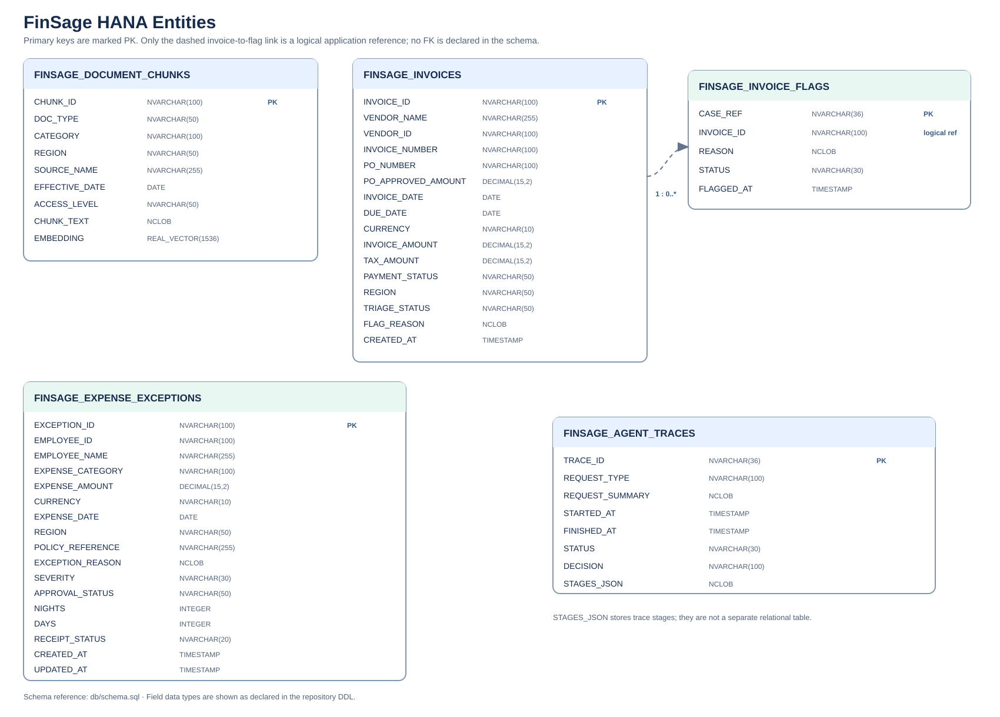

# FinSage HANA ER Diagram

Entities and columns below are based on [`db/schema.sql`](../db/schema.sql).
Data types are shown from the DDL. There is no declared foreign
key in the checked-in DDL. The dashed invoice-to-flag relationship represents
the application-level `INVOICE_ID` reference used by the flagging and reporting
code; HANA does not enforce it as a foreign key.

`FINSAGE_DOCUMENT_CHUNKS`, `FINSAGE_EXPENSE_EXCEPTIONS`, and
`FINSAGE_AGENT_TRACES` are standalone entities in the current schema. Trace
stages are serialized in `STAGES_JSON`; they are not modeled as a separate
relational table.

