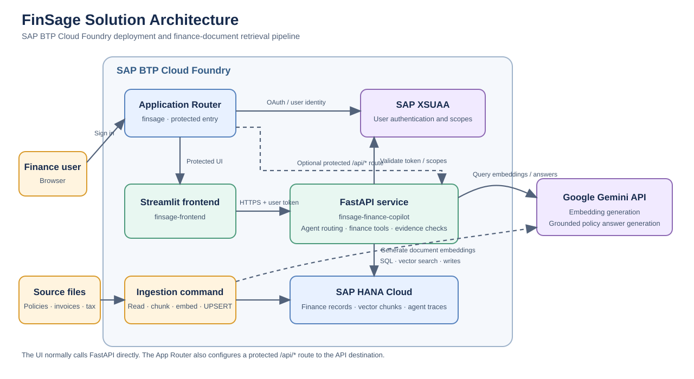

# FinSage Solution Architecture

This diagram reflects the checked-in Cloud Foundry manifests and application
configuration. The Streamlit server sends API requests directly to the FastAPI
HTTPS route with the signed-in user's bearer token. The Application Router also
defines a protected `/api/*` route to the API destination.

## Component responsibilities

- **Application Router and XSUAA:** Sign in users and provide protected routes.
  FastAPI validates the bearer token and applies read/write scope requirements.
- **Streamlit:** Presents finance dashboards, policy Q&A, and controlled action
  forms.
- **FastAPI:** Routes questions to finance tools, retrieval, and evidence checks;
  exposes invoice, expense, trace, and write-action endpoints.
- **SAP HANA Cloud:** Stores finance records, document chunks and vectors, and
  agent execution traces.
- **Gemini:** Creates document/query embeddings and, when verified policy
  evidence is available, generates a policy answer from those excerpts. The
  application has a lexical retrieval fallback and a grounded text fallback.
- **Ingestion command:** Processes the text documents under
  `code/data/documents/`, chunks them, generates embeddings, and upserts them to
  HANA. It is a command-line process, not a separate deployed Cloud Foundry app.

